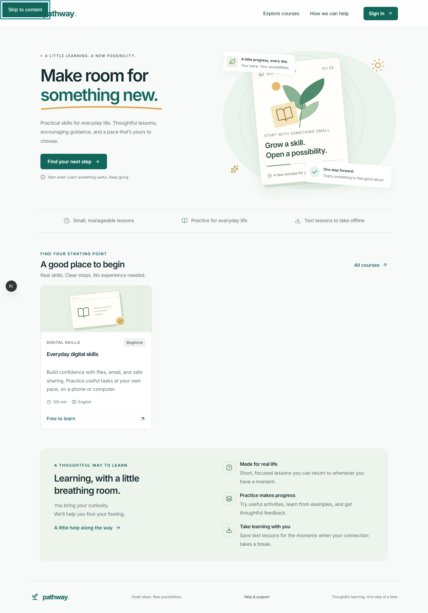

# LumaLearn · Pathway LMS

A learning platform for practical skills, built for clear instruction, reliable progress and learners on phones with interrupted connectivity.


**LumaLearn** is the repository; **Pathway** is the configurable product identity. The application combines a Next.js frontend, a NestJS modular API and a separate worker, with PostgreSQL as the source of truth.



## What it includes

- **Learning:** searchable courses, free/invited/assigned enrollment, prerequisites, saved progress and resume.
- **Assessment:** three practice question types, server-controlled scoring and attempts, recoverable assignment drafts, durable receipts and released feedback.
- **Teaching:** versioned authoring, publication checks, learner preview, rubric grading, revisions and scoped reporting.
- **Administration:** organization memberships, explicit academic permissions, support requests, notices and audit records.
- **Security:** verified contact, cookie sessions, CSRF checks, privileged MFA with recovery codes, private uploads and fail-closed antivirus scanning.
- **Offline reading:** account-scoped text downloads, expiry and acknowledged progress replay. Graded submissions require a connection.

The fictional **Everyday digital skills** course provides a complete demonstration of learning, practice and portfolio feedback. English is the working interface; Tigrinya currently uses an explicit English fallback pending fluent review.

## Quick start

Install **Node.js 24 LTS**, **pnpm 10.28.0** and **Docker Compose v2**. On Windows, start Docker Desktop's Linux engine. Run commands from the repository root.

```sh
corepack enable
corepack prepare pnpm@10.28.0 --activate
pnpm install --frozen-lockfile
```

Create the local API environment once. Preserve an existing configured file.

**PowerShell**

```powershell
Copy-Item .env.example apps/api/.env
```

**Linux / macOS**

```sh
cp .env.example apps/api/.env
```

Start dependencies and wait for PostgreSQL to become healthy, then generate, migrate and seed:

```sh
pnpm infra:up
docker compose -f infra/compose.yaml ps
pnpm db:generate
pnpm db:migrate
pnpm db:seed
```

The first local MinIO source build and ClamAV signature load can take several minutes. The [setup guide](docs/getting-started.md) covers ports, configuration, troubleshooting and the optional Windows PostgreSQL fallback.

Start these in **three separate terminals**:

```sh
pnpm dev:api
pnpm dev:web
pnpm worker
```

| Service              | Address                                                                         |
| -------------------- | ------------------------------------------------------------------------------- |
| Application          | [localhost:3000](http://localhost:3000)                                         |
| API documentation    | [localhost:4000/api/v1/docs](http://localhost:4000/api/v1/docs)                 |
| Local email inbox    | [localhost:8025](http://localhost:8025)                                         |
| Dependency readiness | [localhost:4000/api/v1/health/ready](http://localhost:4000/api/v1/health/ready) |

Use `localhost:3000` consistently so the configured browser origin and cookies agree. **Local registration and recovery email goes to Mailpit**, including when you register with a Gmail address. Open the local inbox above to follow the verification link.

Windows users can also use `scripts/start-local.ps1` and `scripts/stop-local.ps1` to manage hidden local processes and logs. Stop terminal-run processes with Ctrl+C; `pnpm infra:down` preserves named data volumes. API source changes require a rebuild/restart; the frontend reloads during development.

## Try the workflows

Fresh demonstration accounts use **`PathwayDemo!2026`**, unless `DEMO_PASSWORD` was changed before the first seed. Seed preserves existing passwords and learning records.

| Account                    | Role                                                         |
| -------------------------- | ------------------------------------------------------------ |
| `learner@pathway.local`    | Enrolled learner with example progress and released feedback |
| `learner2@pathway.local`   | Independent learner for joining a course                     |
| `instructor@pathway.local` | Instructor assigned to the demonstration course              |
| `admin@pathway.local`      | Organization administration                                  |
| `support@pathway.local`    | Scoped support handling                                      |

Privileged accounts must enroll a TOTP authenticator in Profile. Save the one-time recovery codes securely; used codes cannot be reused. The ordinary ADMIN role does not automatically grant academic-record access.

Follow the [demo walkthrough](docs/demo-guide.md) for enrollment, lessons, grading, authoring, support and offline reading. Production onboarding uses the [organization bootstrap operation](docs/operations.md#production-application-template), with unique credentials and real SMTP.

## Architecture

```text
apps/
  api/
    src/          NestJS domain modules, permissions, adapters and worker
    prisma/       Schema, ordered migrations and fictional seed
    test/         Unit and real-PostgreSQL API checks
  web/
    src/          Next.js routes, feature components, locales and browser storage
    public/       Public assets and offline service worker
packages/
  api-client/     OpenAPI contract and typed frontend client
  config/         Shared TypeScript configuration
infra/            Local stack and separate production container targets
scripts/          Contract generation, lifecycle and verification tools
tests/            Browser workflows and accessibility checks
docs/             Architecture, evidence, runbooks and requirements
.github/          Continuous integration
```

Controllers handle HTTP contracts; domain services enforce permissions and transactions. Enrollments retain immutable published course versions. The durable outbox connects committed database work to BullMQ email, notices and scanning jobs. See the [architecture](docs/architecture.md) and [contribution guide](CONTRIBUTING.md) for boundaries and conventions.

## Verification

```sh
pnpm format:check
pnpm lint
pnpm typecheck
pnpm test
pnpm build
pnpm test:e2e
pnpm audit:production
```

API integration tests require a separately migrated database ending in `_test`; browser checks require the running local stack. Prepare them using the [setup guide](docs/getting-started.md#checks-and-test-database).

The current verification record includes **57 API/unit checks**, **10 live adapter checks**, and **15 browser scenarios**. Browser coverage includes learner flows at 360, 768 and 1440 pixels, teaching and management workflows, offline reloads, account recovery and onboarding. Production dependency audit reports zero advisories; the full development graph retains one documented low-severity Jest dependency finding. These results describe bounded local checks. See the dated [verification record](docs/verification.md) for exact evidence and remaining acceptance work.

Additional tools exercise real SMTP/storage/scanning (`pnpm services:verify`), a bounded local restore (`pnpm recovery:verify`) and local load (`pnpm load:verify`). Read their prerequisites before execution. CI defines quality, database, browser, dependency and container checks; no hosted CI success is implied by these definitions.

## Deployment and maintenance

Production builds use separate **API**, **standalone web** and **migration** image targets. The worker uses the API image with its own command. The [production Compose template](infra/compose.production.yaml) requires explicit image references, private dependencies, a restricted environment file and an existing HTTPS proxy network; it publishes no host ports.

Real learner deployment still requires provider-specific security review, supported private storage, HTTPS/SMTP setup, representative Android/accessibility checks, operational ownership and a production restore/rollback rehearsal. The local archived-source MinIO adapter is for development. No public deployment or paid infrastructure is created by setup.

| Documentation                                     | Purpose                                                          |
| ------------------------------------------------- | ---------------------------------------------------------------- |
| [Detailed setup](docs/getting-started.md)         | Environment variables, test database, ports and Windows fallback |
| [Demo walkthrough](docs/demo-guide.md)            | Learner, teaching and administration workflows                   |
| [Architecture](docs/architecture.md)              | Data boundaries, permissions, jobs and offline behavior          |
| [Operations](docs/operations.md)                  | Containers, bootstrap, backups, recovery and incidents           |
| [Verification](docs/verification.md)              | Executed checks and evidence limits                              |
| [Requirements](docs/requirements-traceability.md) | Implementation mapping and honest status                         |
| [Dependency review](docs/dependency-review.md)    | Security patches and the remaining tooling advisory              |
| [Backlog](docs/backlog.md)                        | Deferred scope and release gates                                 |
