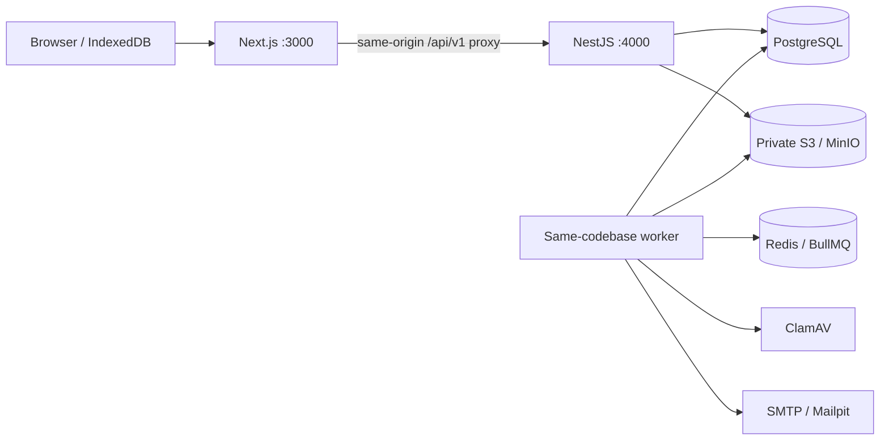

# Pathway architecture

## Application boundaries

Next.js owns presentation and routing. NestJS owns authentication, organization scope, publication, enrollment, scores, deadlines, grades, and progress. REST routes live under `/api/v1`; Swagger is exposed at `/api/v1/docs`. Next rewrites same-origin API requests to the Nest service. PostgreSQL is the authoritative data store. The frontend never supplies a trusted actor, role, or organization.

The modular monolith separates auth, users, organizations, memberships, courses, enrollments, learning, assessments, submissions, grading, media, notifications, support, reporting, audit, and health. A separate worker process from the same codebase handles retryable jobs. Redis is temporary queue state; a database outbox supplies a durable handoff. MinIO/S3 holds private blobs, while the database tracks ownership and scanning state. NestJS 11.2.8 and Swagger 11.4.7 use the CommonJS/decorator metadata pipeline required by the current Jest/TypeScript configuration. Development runs compiled API JavaScript, not a transpiler that omits injection metadata.

## Authentication and authorization

Passwords use Argon2id. Sessions use opaque random tokens in HttpOnly cookies, with only token hashes stored in PostgreSQL. The cookie is host-only, `Path=/`, `SameSite=Lax`, and Secure for production or explicit HTTPS configuration. Production uses the `__Host-pathway_session` name. Configured expiry defaults to 24 hours, capped at 12 hours for privileged accounts. Login rotates the token by creating a new session; logout, recovery, membership changes and revoke-all invalidate applicable records.

Authenticated mutations require the session's CSRF token in `X-CSRF-Token`. The guard rejects a supplied untrusted Origin and cross-site fetch metadata; non-browser clients without an Origin still need CSRF. Public authentication writes receive origin checks and rate limits. Browser calls use the same-origin proxy with cookies and retain CSRF only in memory. Long-lived credentials never enter localStorage. SSR does not fetch private account data. Any future SSR account request must explicitly forward only the caller's cookie to the internal API and disable caching. API responses use `Cache-Control: no-store`.

Every protected request reloads the session and membership; suspension/revocation affects subsequent requests. Instructor assignment is checked per course. ADMIN manages memberships but does not automatically gain academic access; ACADEMIC_ADMIN is an explicitly delegated permission. Support access is scoped and auditable, with no grading or impersonation capability. Privileged accounts require TOTP MFA. The established `otplib` implementation validates codes; AES-256-GCM protects stored secrets using a deployment key, and the last used step prevents code replay. There is no custom cryptographic primitive, MFA bypass, or lost-authenticator self-service recovery.

Organization membership and ownership are enforced in guards, service policies and scoped queries. This implementation does not claim PostgreSQL row-level security. Deployment must use a constrained application database role and protect direct database access. Search exposes public published course metadata; academic data requires authorization separately.

## Learning records

Enrollment is unique per user/course and pins a published course version. Publishing creates immutable content; edits use a new draft. Question snapshots bind attempts to the exact scoring content. The server computes scores, enforces retries/timing, and never accepts client scores. Viewed, completed, and passed are separate states. Unique progress IDs make replay idempotent; completion cannot regress when an older device reconnects.

Assignment drafts are separate from server-confirmed submission receipts. Uploaded assets must be CLEAN before a submission accepts them. Rubrics freeze when the draft is first created; immutable published activity versions preserve their source. A unique request ID and receipt snapshot preserve the submitted content for each revision. Grade revisions, submission-revision references and release timestamps retain private feedback until explicit release. Sensitive publication, membership and grade changes leave audit records.

Database transactions and uniqueness constraints serialize enrollment creation, progress replay, attempt submission, grading release and durable job handoffs. Additional migration triggers freeze published content, immutable attempt snapshot fields and durable receipts, and validate enrollment/activity version relationships. Prisma migrations are part of the application contract; running the schema generator alone does not install these invariants.

## Storage and background processing

Uploads are bounded to 10 MiB and validate a PDF/PNG/JPEG signature or UTF-8 text/CSV payload. Complete uploads are written privately, then a transaction records QUARANTINED metadata plus its scan event; a failed transaction attempts orphan cleanup. UPLOADING assets cannot be submitted. Only a real ClamAV clean verdict makes an asset CLEAN; suspicious content is REJECTED, and unavailable/ambiguous scanning fails closed. Download links are issued after ownership/teaching authorization and expire after 60 seconds. There is no public bucket policy. Media URLs are not a permanent authorization grant.

BullMQ uses stable outbox IDs, five attempts and exponential backoff. The dispatcher rechecks durable PENDING/QUEUED database events, including after Redis loss. The worker locks each outbox row while delivering it. In-app notices and reminders deduplicate by event/user ID. Failed jobs are visible and can be replayed by organization administrators. SMTP is at-least-once delivery: if delivery succeeds and the database commit fails, a retry may deliver again despite the deterministic Message-ID. No provider-level exactly-once claim is made. Successfully delivered email payloads are erased; failed payload retention needs an operating policy.

The local MinIO server and client are built from pinned upstream commits because the previously distributed images were unavailable. Upstream repositories are archived; this is a reproducible local adapter, not a maintained production-storage recommendation. A supported private S3-compatible service can use the same adapter without changing learning logic. Video transcoding, multiple bitrate renditions and report-export workers are not enabled.

## Offline pilot

Selected permitted text lessons use account-scoped IndexedDB records with content version, expiry, byte size and removal controls. Only permitted lesson progress is queued with unique IDs. Entries remain until server acknowledgment. Assessments and submissions require a connection. Sign-out clears private caches. Browser eviction, device storage loss, expired access and disconnected revocation cannot be made invisible; the UI reports local save separately from account sync. Offline access is a convenience, not permanent storage.

The service worker caches a public offline shell and static application assets, never API responses, instructor/admin records or private media. A valid cached identity allows the downloaded-text view to reopen without exposing other accounts' entries. Offline expiry is seven days and is checked by the client. Resource binaries and video are not included in downloads. Reauthentication is necessary before queued changes can receive server acknowledgment. Grades never use local progress as evidence.

## Presentation and content safety

The Pathway palette is encoded as semantic CSS tokens, with local Inter and Noto Sans Ethiopic fonts. Product branding is kept in `brand.ts`. Rich lesson text uses escaped React text rendering rather than arbitrary HTML. The interface language and course language are stored separately. Tigrinya currently declares English fallback; it has no professionally reviewed translation set. Human content review remains necessary for accessibility, licensing, cultural fit and instructional quality.

## Deployment boundaries

The Next rewrite destination is set at build time with `API_INTERNAL_URL`; setting it only on a running container does not rebuild that route. The supplied application Dockerfile accepts the build argument. The alternative is an edge reverse proxy that routes `/api/v1` directly to the API under the same public origin. Separate API and worker processes share one codebase, not a single process. Health probes distinguish API liveness from readiness of all required dependencies.

Free enrollment is the only commerce model. Payments, public community, hosted project workspaces, standards integrations and AI assistance are deliberately separate future boundaries. No public deployment or paid service has been created.

## References checked during implementation

- [NestJS validation](https://docs.nestjs.com/techniques/validation): transformation, whitelist and unknown-property rejection.
- [NestJS authentication](https://docs.nestjs.com/security/authentication) and [CSRF guidance](https://docs.nestjs.com/security/csrf).
- [OWASP session management](https://cheatsheetseries.owasp.org/cheatsheets/Session_Management_Cheat_Sheet.html).
- [BullMQ idempotent jobs](https://docs.bullmq.io/patterns/idempotent-jobs).
- [Next.js installation](https://nextjs.org/docs/app/getting-started/installation).
- Pinned local object-storage source: [MinIO server](https://github.com/minio/minio) at `7aac2a2c5b7c882e68c1ce017d8256be2feea27f` and [MinIO client](https://github.com/minio/mc) at `77f82e18b5401a65958f1619df6ebb994634bd88`.

Package metadata was checked against the npm registry. Prisma 6.19.3 is intentionally pinned to its established schema.prisma/migrate-deploy API; current major-version documentation must not be applied uncritically to this pinned release.
